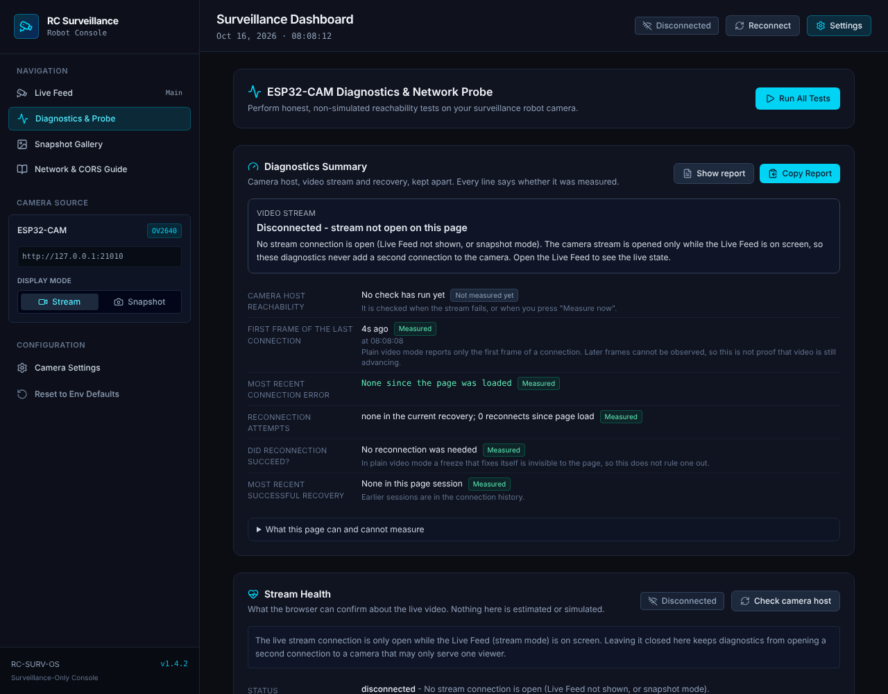
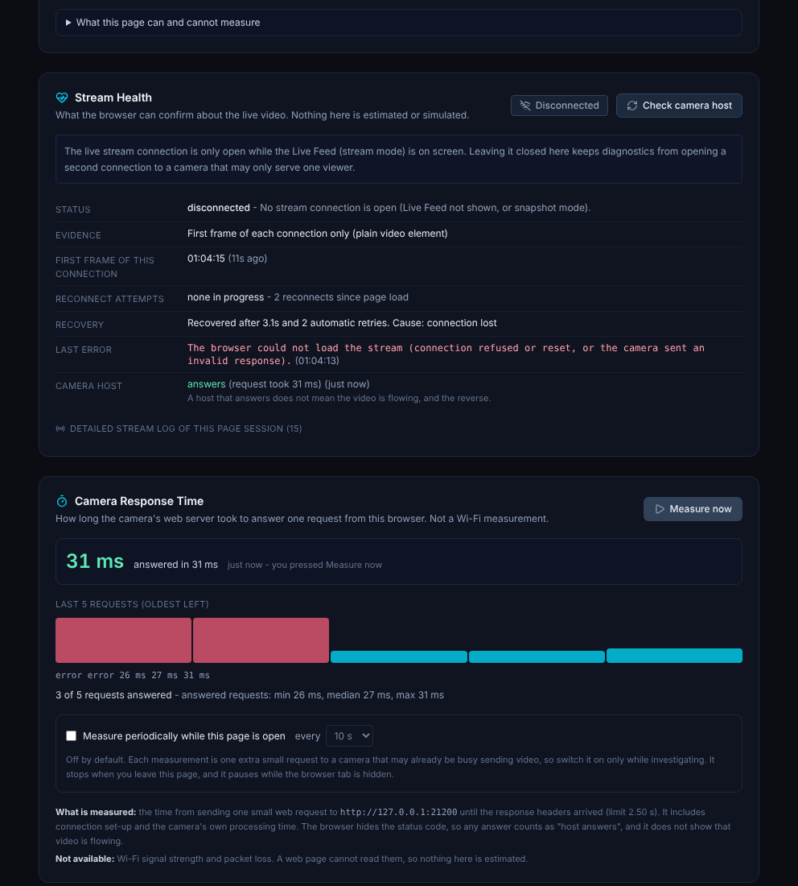
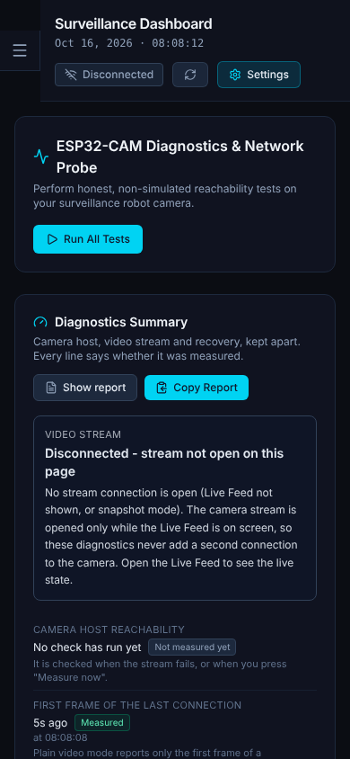
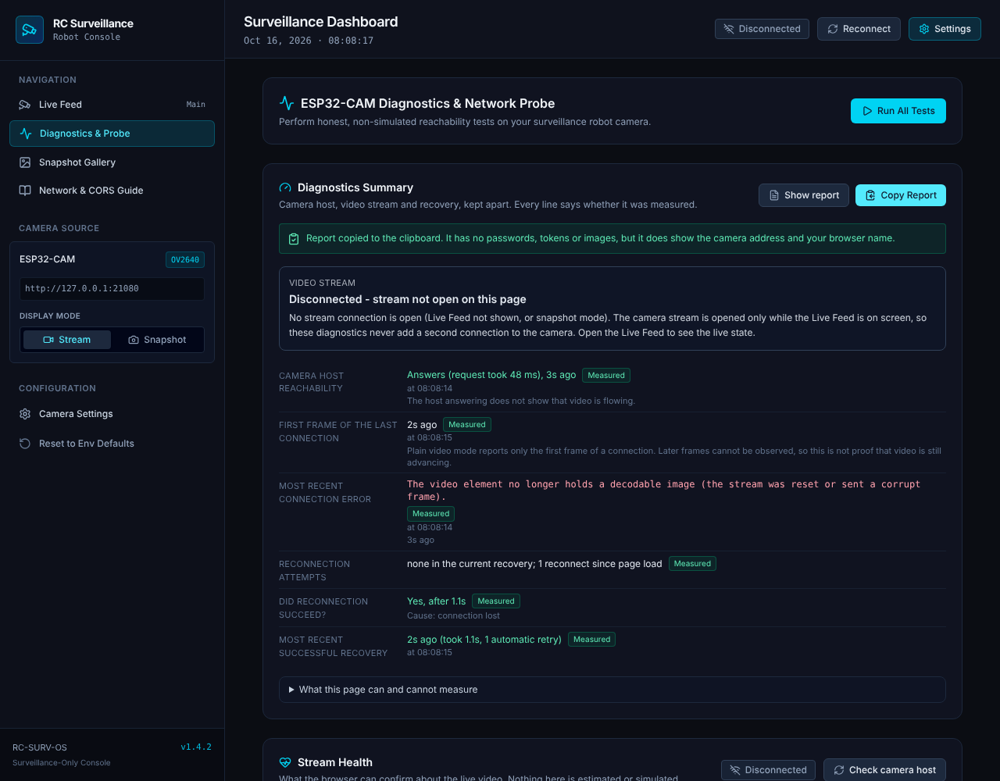
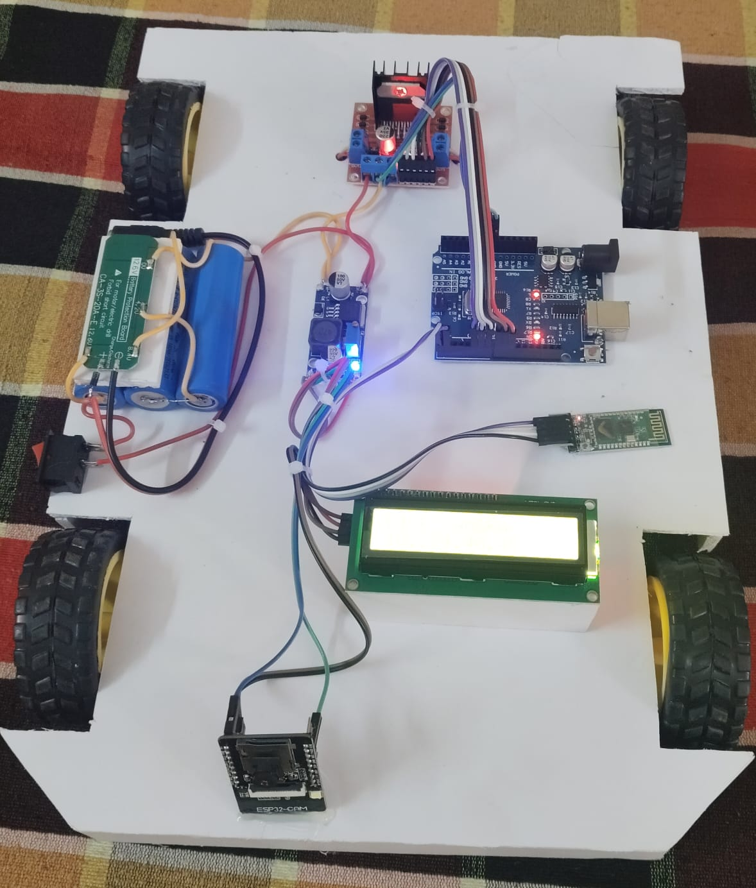
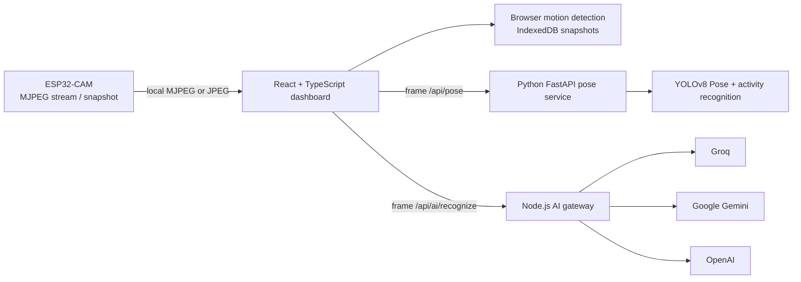

# RC Surveillance Robot

> A local-first surveillance dashboard for an ESP32-CAM stream, browser-side monitoring, and optional AI-assisted scene analysis.

[](https://react.dev/)
[](https://www.typescriptlang.org/)
[](https://vite.dev/)
[](https://fastapi.tiangolo.com/)



## Overview

RC Surveillance Robot is the software console for monitoring an ESP32-CAM-equipped robot on a local network. It presents the camera stream, connection state, motion events, snapshots, diagnostics, and optional visual analysis in one React dashboard.

The ESP32-CAM supplies an MJPEG stream or still-image endpoint; the dashboard does not include motor-driver firmware, steering controls, or autonomous navigation. When the camera permits browser frame access through CORS, the browser can capture frames for smart snapshots, motion detection, local pose estimation, and optional cloud AI recognition.

Local computer vision runs through a loopback FastAPI service using YOLOv8 Pose. It returns human keypoints and feeds a temporal activity-recognition layer. Cloud scene recognition is kept separate behind a local Node.js gateway, which supports Groq, Google Gemini, and OpenAI without exposing provider keys to the browser.

## Features

- ESP32-CAM MJPEG streaming with configurable stream and snapshot routes.
- Connection monitoring, manual reconnect, bounded automatic retries, and connection history.
- Browser-side motion detection and motion-event history.
- Smart snapshots stored in the browser's IndexedDB, with download and deletion controls.
- Local YOLOv8 Pose estimation and temporal human activity recognition through FastAPI.
- A local Node.js AI gateway with Groq, Google Gemini, and OpenAI provider adapters.
- AI event history, diagnostics, redacted diagnostic-report export, and configurable settings.
- Two deployment modes: a key-free public demo build and local hardware mode.

## Screenshot gallery

The repository currently contains real diagnostics captures only. They are shown below without substituting mockups for the other pages.

| Dashboard diagnostics | Recovery diagnostics |
| --- | --- |
|  |  |

| Mobile diagnostics | Report export |
| --- | --- |
|  |  |

Screenshots for AI Recognition, Pose Estimation, Motion Detection, Snapshots, Event History, and Settings have not been added because no verified captures for those views are present in the repository.

## Real Hardware Prototype

Photographs of the physical RC Surveillance Robot test prototype:

| Prototype top view | Front camera elevation |
| --- | --- |
|  |  |

| Component breakdown |
| --- |
|  |

### Hardware components

| Component | Role | Verification status | Notes |
| --- | --- | --- | --- |
| **Arduino Uno** | Main controller | Visually verified on prototype | Microcontroller coordinating onboard logic and peripheral signaling |
| **ESP32-CAM** | Camera module | Visually verified on prototype | Forward-mounted optical capture unit with 2.4 GHz Wi-Fi for local MJPEG/JPEG streaming |
| **HC-SR04** | Ultrasonic distance sensor | Architecture specification | Specified in system design BOM for ranging; unmounted on current chassis deck |
| **Bluetooth module** | Wireless communication | Visually verified on prototype | Serial communication transceiver wired for local telemetry |
| **L298N** | Motor driver | Visually verified on prototype | Dual H-bridge driver module with heatsink for driving DC propulsion motors |
| **DC motors & wheels** | Mobility | Visually verified on prototype | Geared DC motors and rubber treaded wheels mounted on the chassis |
| **Battery pack & buck converter** | Power supply & regulation | Visually verified on prototype | Multi-cell battery assembly with protection board (BMS) and step-down buck converter |
| **LCD display** | Information display | Visually verified on prototype | 16x2 alphanumeric display module for status and network feedback |

### Prototype status and operational reality

- **Physical hardware prototype:** The photographs above document the physical benchtop assembly. The platform includes an Arduino Uno, forward-facing ESP32-CAM, power regulation, motor driver, LCD screen, and chassis.
- **Simulated public showcase:** The hosted public demonstration website uses simulated data and pre-rendered layouts. It does not communicate with or send commands to the physical robot.
- **Honest boundaries:** Autonomous navigation, obstacle avoidance, on-device microcontroller AI inference, and closed-loop wireless control are not implemented or verified in this repository.

## Architecture



The browser talks directly to the camera on the local network. It sends selected frames to the loopback pose service or Node gateway only when those features are used. The Node gateway makes the external provider request and keeps provider keys server-side. This diagram describes the software; physical motor control is outside this project.

For implementation details, see [the architecture guide](docs/architecture.md).

## Technology stack

| Layer | Technology |
| --- | --- |
| Dashboard | React, TypeScript, Vite, Tailwind CSS |
| AI gateway | Node.js native HTTP server |
| Local vision | Python, FastAPI, Ultralytics YOLOv8 Pose, PyTorch |
| Browser storage | IndexedDB and localStorage |
| Optional AI providers | Groq, Google Gemini, OpenAI APIs |
| Camera | ESP32-CAM-compatible MJPEG/JPEG HTTP endpoints |

## Installation

### Prerequisites

- Node.js `>=20.19.0` and npm
- Python 3.10 or later
- An ESP32-CAM only for local hardware mode

```bash
git clone https://github.com/Tech-pranav-21/WebVerse.git
cd "WebVerse/RC Surveillance Robot/frontend"
npm install

cd ../activity-recognition
python -m pip install -r requirements.txt
```

Create the local configuration file from `frontend/`:

```powershell
Copy-Item .env.example .env
```

Set the camera URL and only the AI-provider keys you intend to use. Keep `.env` local; it is ignored by Git. See the [setup guide](docs/setup-guide.md) for the exact variables and terminal sequence.

Run the services in separate terminals:

```bash
# frontend/
npm run server

# frontend/
npm run dev

# activity-recognition/
python run_service.py
```

Open `http://localhost:3000`.

## Demo and local hardware modes

| | Public demo | Local hardware |
| --- | --- | --- |
| Build command | `npm run build:demo` | `npm run dev` |
| Camera | No camera configured | ESP32-CAM on the local network |
| AI gateway and pose service | Not required | Required for their respective features |
| Provider keys | Never bundle them | Stored only in local `frontend/.env` |

The public demo is a key-free presentation build. It shows a clearly marked simulated camera layout, sample AI/motion/pose/snapshot/event/diagnostic states, and a hardware overview; it makes no camera, localhost, AI-provider, or pose-service request. It does not use fabricated footage or claim that its sample results are live. Live streaming, browser-readable frame features, pose estimation, and live provider calls require Local Hardware Mode and, where applicable, an ESP32-CAM configured for CORS.

### Static deployment

Vercel is configured in `frontend/vercel.json`: it runs `npm ci`, builds with `npm run build:demo`, and publishes `frontend/dist`. For another static host, use the same command and deploy `dist/`. Do not add `.env`, camera addresses, provider keys, or a local API proxy to the public deployment. The showcase has no price, inventory, or purchase link; to show a verified contact, set `VITE_PROJECT_CONTACT_URL` to an `https://` or `mailto:` address at build time. It is public by design and must not contain a secret.

## Limitations

- Live ESP32-CAM integration has not been verified in this repository.
- Live Groq, Gemini, and OpenAI requests have not been verified here.
- Physical motor control and autonomous navigation are not implemented.
- Motion analysis, snapshots, pose estimation, and AI frame submission depend on browser-readable camera frames; a camera without suitable CORS headers restricts those features.
- The project needs a compatible ESP32-CAM firmware image, a 2.4 GHz local network, and appropriate power hardware; firmware is not included.

## Roadmap

- Add verified captures for each dashboard view.
- Validate the local hardware flow with a documented ESP32-CAM firmware configuration.
- Add integration evidence for each supported AI provider.
- Evaluate a low-latency stream transport after hardware validation.

## Documentation

- [Setup guide](docs/setup-guide.md)
- [Hardware and network guide](docs/hardware-guide.md)
- [Architecture](docs/architecture.md)

## License

No repository-level license file is currently included. Do not assume a license grant until one is added.
