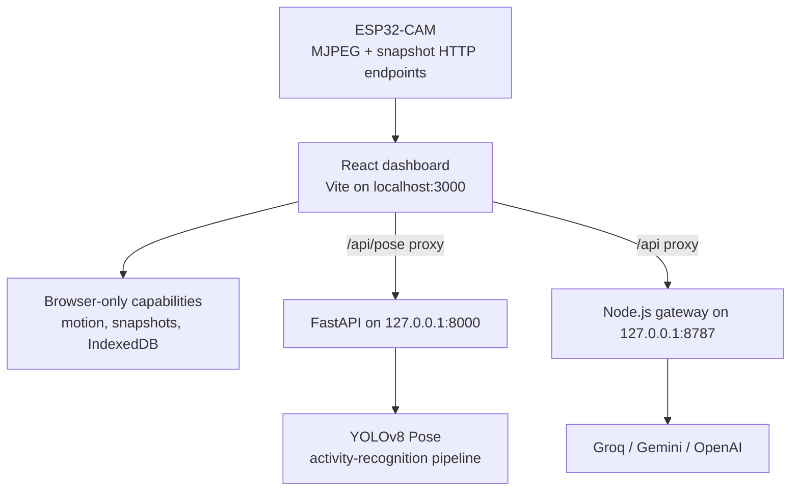

# Architecture

## System boundaries

The dashboard is split into three independently started local services. The camera is an HTTP device on the local network; provider APIs are optional external services.

## Responsibilities

### React dashboard

The dashboard renders the camera feed and user interface. It owns local settings, diagnostic and event presentation, frame sampling, browser-side motion detection, and the IndexedDB snapshot library. Vite proxies `/api/pose` to the FastAPI process and `/api` to the Node service during local development.

The browser loads the ESP32-CAM stream directly. A normal image stream can display without CORS, but browser processing of its pixels requires the camera firmware to return appropriate CORS headers. The dashboard deliberately exposes that distinction in its settings and network guidance.

### Node.js AI gateway

`frontend/server/` receives AI recognition and provider-health requests. It validates incoming image payloads, applies limits and origin checks, selects a provider adapter, and redacts secrets from logs and errors. Provider credentials stay in the server process environment rather than in Vite-exposed variables or browser storage.

The gateway has adapters for Groq, Gemini, and OpenAI. The selected provider is configurable; actual provider availability depends on valid local credentials and network access.

### Python pose and activity service

`activity-recognition/` runs a FastAPI service bound to loopback by default. It accepts an image, runs YOLOv8 Pose, and returns detected people and 17-keypoint pose data. A per-session temporal layer tracks poses across frames to derive activity labels when there is enough evidence. The service can use CUDA when available or fall back to CPU.

### Data and privacy

Snapshots and UI preferences are browser-local (IndexedDB and localStorage). The system has no application database. Frames leave the local machine only when the user invokes an enabled cloud-AI provider; pose processing remains in the local FastAPI service.

## Deployment modes

`vite build --mode demo` produces the public-demo mode. It starts with no camera and does not package AI keys. Local hardware mode is the development/local deployment path, in which the browser can reach a camera on the same network and the optional backend processes are started separately.

## Out of scope

This repository documents camera surveillance software. It contains no motor-driver firmware, motor-control API, steering interface, or autonomous-navigation system. Those would be separate physical-control concerns.
